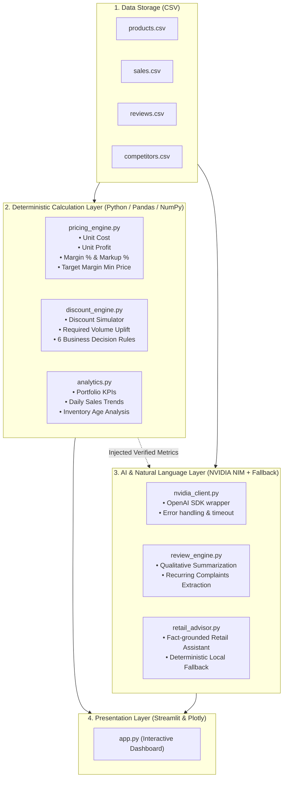

# RetailPulse AI — Intelligent Retail Pricing, Discount & Customer Satisfaction Intelligence System

[](https://www.python.org/)
[](https://streamlit.io/)
[](https://plotly.com/)
[](https://build.nvidia.com/)
[]()

> **Academic Project Submission:** B.Tech Computer Science & Engineering (AI & ML)  
> **Team Size:** 4 Students  
> **Target Audience:** Retail shop owners, category merchandisers, and inventory managers  

---

## 1. Project Introduction & Problem Statement

### The Retail Dilemma
Small and medium retailers often make reactionary, unprofitable decisions when sales slow down or customer complaints rise. Common pitfalls include:
1. **The Blanket Discount Trap:** Slashing prices on defective products when customers are complaining about product quality, not price. Price cuts do not fix broken products.
2. **Margin Surrender:** Offering discounts on fast-moving products with critically low inventory, prematurely wiping out profit margins.
3. **Dead Capital:** Holding onto aged, stagnant inventory without taking phased markdowns to recover working capital.
4. **Intuition-Based Pricing:** Pricing products without calculating the true minimum price required to achieve target gross margins.

### The Solution: RetailPulse AI
**RetailPulse AI** is a decision-support intelligence platform built specifically for **retailers** (not customers). It unifies:
- **Deterministic Python calculations** for unit costs, gross margins, markups, target margin minimum prices, and break-even volume uplift.
- **Explainable business heuristic rules** across sales trends, stock levels, inventory shelf age, and competitor prices.
- **NVIDIA NIM hosted AI (via OpenAI SDK)** for customer review sentiment summarization and natural-language business advisory.
- **Zero-Crash Local Fallback:** Complete functionality remains available offline even when an API key is missing or external services are unreachable.

---

## 2. Key Objectives

1. **Customer Satisfaction Intelligence:** Quantify customer sentiment and extract recurring complaints from review text.
2. **Price Soundness Verification:** Assess whether current prices achieve target profit margins considering purchase and variable costs.
3. **Interactive Discount Simulation:** Calculate exact profit impact, margin degradation, and required sales volume uplift before running promotions.
4. **Actionable Recommendations:** Provide explainable, multi-factor business recommendations (e.g., investigate defects first, avoid unnecessary discounts, phased clearance).
5. **AI Retail Advisor:** Empower store owners to ask natural-language questions grounded strictly in Python-verified figures.

---

## 3. Technology Stack

| Layer | Technology | Purpose |
| :--- | :--- | :--- |
| **Language** | Python 3.10+ | Core programming and business logic |
| **User Interface** | Streamlit | Responsive, professional analytical web dashboard |
| **Data Processing** | Pandas, NumPy | Financial calculations, aggregations, and metrics |
| **Visualizations** | Plotly | Interactive time-series trends and comparative charts |
| **AI Integration** | NVIDIA NIM Hosted API | Cloud LLM inference (e.g. `meta/llama-3.1-70b-instruct`) |
| **API Client** | OpenAI Python SDK | Standardized client configured for NVIDIA NIM base URL |
| **Data Storage** | Normalized CSV files | Portable, lightweight, transparent data storage |
| **Configuration** | python-dotenv | Secure environment variable handling |
| **Testing** | pytest | Automated unit and integration testing suite |

---

## 4. System Architecture & Guardrails

### Strict Architectural Separation


### Critical Architectural Guardrails:
1. **No LLM Financial Calculations:** The AI model is strictly prohibited from computing revenue, calculating margins, or inventing prices. All numbers are calculated by Python and injected into the prompt as ground-truth facts.
2. **Zero-Crash Resilience:** If `NVIDIA_API_KEY` is missing or API limits are reached, the application automatically switches to the built-in deterministic local NLP engine. The dashboard **never crashes**.
3. **Mathematical Bounds:** Margin calculations guard against division-by-zero. Volume uplift calculations explicitly warn when discounts result in zero or negative profit.

---

## 5. Folder Structure

```
RetailPulse-AI/
│
├── app.py                      # Main Streamlit web application & UI
├── analytics.py                # Data loading, KPI aggregation, and trends
├── pricing_engine.py           # Unit cost, margins, and target price calculations
├── discount_engine.py          # Discount simulator and business decision heuristics
├── review_engine.py            # Customer sentiment and complaint analysis (AI + Fallback)
├── nvidia_client.py            # NVIDIA NIM API client configured with OpenAI SDK
├── retail_advisor.py           # AI Retail Advisor & grounded Q&A engine
│
├── data/                       # Synthetic retail datasets (Indian Rupees ₹)
│   ├── products.csv            # Master product catalog with costs, stock, target margins
│   ├── sales.csv               # 40-day transactional sales history
│   ├── reviews.csv             # Customer star ratings and qualitative reviews
│   └── competitors.csv         # Market price benchmarks from competing retailers
│
├── tests/                      # Automated test suite (27 unit & integration tests)
│   ├── test_pricing.py         # Pricing formulas, margin checks, edge cases
│   ├── test_discount.py        # Discount simulator, volume uplift, heuristic rules
│   ├── test_analytics.py       # Data loading and KPI aggregation tests
│   ├── test_reviews.py         # Review sentiment and offline fallback tests
│   └── test_integration.py     # End-to-end demo scenario validation
│
├── specifications/             # Full engineering specifications
│   ├── PRD.md                  # Product Requirements Document
│   ├── ARCHITECTURE.md         # System Architecture & Component Design
│   ├── DATA_MODEL.md           # Schema, Data Dictionary & Scenario Definitions
│   ├── IMPLEMENTATION_PLAN.md  # Milestones, delivery stages, risk matrix
│   └── TEST_PLAN.md            # Quality Assurance & Test Case Matrix
│
├── TEAM_TASKS.md               # 4-Member Student Team Responsibilities & Viva Guide
├── .env.example                # Sample environment configuration template
├── .gitignore                  # Git ignore rules
├── requirements.txt            # Python dependencies
└── README.md                   # Comprehensive project documentation
```

---

## 6. Synthetic Demonstration Scenarios

All figures represent realistic **synthetic demonstration data** denominated in Indian Rupees (₹) and clearly labelled:

| SKU ID | Product Name | Cost (₹) | Selling Price (₹) | Stock | Rating | Business Situation & Expected Recommendation |
| :--- | :--- | :--- | :--- | :--- | :--- | :--- |
| **PRD001** | Organic Darjeeling Green Tea 250g | ₹250.00 | ₹450.00 | 15 units | 4.60 ⭐ | **Fast Mover & Low Stock:** Demand is high; inventory low. *Recommendation:* Avoid unnecessary discount; reorder stock. |
| **PRD002** | Aura Sound Wireless Headphones | ₹1,000.00 | ₹1,499.00 | 100 units | 3.20 ⭐ | **Declining Sales & Battery Complaints (Demo SKU):** Sales falling, 100 units in stock, battery complaints. *Recommendation:* Investigate product quality first; do not discount. |
| **PRD003** | PulseTrack Smart Fitness Watch | ₹1,500.00 | ₹2,499.00 | 80 units | 3.60 ⭐ | **Moderate Demand & Healthy Quality:** Healthy 40% margin. *Recommendation:* Consider a small controlled promotion (5-10%). |
| **PRD004** | HydroShield Thermal Bottle 1L | ₹400.00 | ₹799.00 | 65 units | 4.80 ⭐ | **Cash Cow / High Satisfaction:** Consistent sales, top durability reviews. *Recommendation:* Maintain current price. |
| **PRD005** | Heritage Canvas Travel Duffel Bag | ₹900.00 | ₹1,899.00 | 55 units | 3.75 ⭐ | **Aged Inventory (>90 Days):** Slow-moving, capital locked up. *Recommendation:* Consider a phased markdown clearance. |

---

## 7. Mathematical Formulations

### 1. Unit Cost
$$\text{Unit Cost} = \text{Purchase Cost} + \text{Variable Cost}$$

### 2. Unit Profit (Contribution)
$$\text{Unit Profit} = \text{Selling Price} - \text{Unit Cost}$$

### 3. Gross Profit Margin Percentage
$$\text{Margin } (\%) = \left(\frac{\text{Unit Profit}}{\text{Selling Price}}\right) \times 100$$

### 4. Markup Percentage
$$\text{Markup } (\%) = \left(\frac{\text{Unit Profit}}{\text{Unit Cost}}\right) \times 100$$

### 5. Minimum Selling Price for Target Margin
$$\text{Minimum Price} = \frac{\text{Unit Cost}}{1 - \text{Target Margin Decimal}}$$
*Verification:* If Unit Cost = ₹1,000 and Target Margin = 30% (0.30):
$$\text{Min Price} = \frac{1000}{1 - 0.30} = \frac{1000}{0.70} = ₹1,428.57$$
$$\text{Check: } \frac{1428.57 - 1000}{1428.57} = 30.0\%$$

### 6. Discounted Selling Price
$$\text{Discounted Price} = \text{Current Price} \times \left(1 - \frac{\text{Discount } \%}{100}\right)$$

### 7. Maximum Allowable Discount to Preserve Target Margin
$$\text{Max Discount } (\%) = \max\left(0.0, \, \left(1 - \frac{\text{Minimum Target Price}}{\text{Current Price}}\right) \times 100\right)$$

### 8. Required Sales Volume Uplift to Maintain Prior Gross Profit
$$\text{Required Volume Uplift } (\%) = \left(\frac{\text{Current Unit Profit}}{\text{Discounted Unit Profit}} - 1\right) \times 100$$
*Mathematical Guard:* If $\text{Discounted Unit Profit} \le 0$, the platform flags that no amount of sales volume can recover gross profit, as every sale yields a loss.

---

## 8. Installation & Setup Guide

### Prerequisites
- Python 3.10, 3.11, 3.12, or 3.13 installed.
- Git (optional).

### Step 1: Clone or Navigate to Project
```bash
cd "d:\PROJECTS\retail ai"
```

### Step 2: Create and Activate Virtual Environment
**Windows (PowerShell or Command Prompt):**
```bash
python -m venv .venv
.venv\Scripts\activate
```

**macOS / Linux:**
```bash
python3 -m venv .venv
source .venv/bin/activate
```

### Step 3: Install Required Dependencies
```bash
pip install -r requirements.txt
```

### Step 4: Configure Environment Variables
Copy `.env.example` to `.env`:
```bash
copy .env.example .env
```
Open `.env` in any text editor:
```ini
# NVIDIA NIM API Settings (Hosted at NVIDIA API Catalog)
NVIDIA_API_KEY=your_actual_api_key_here
NVIDIA_MODEL=meta/llama-3.1-70b-instruct
NVIDIA_BASE_URL=https://integrate.api.nvidia.com/v1
```

> [!NOTE]
> **Running Without an NVIDIA API Key:**  
> If you do not have an active NVIDIA API key, leave `NVIDIA_API_KEY` as is. RetailPulse AI will automatically run in **Local Fallback Mode**, providing instant deterministic review analysis and rule-based advice with **zero crashes**.

### Step 5: How to Obtain a Free NVIDIA NIM API Key
1. Visit the [NVIDIA API Catalog](https://build.nvidia.com/).
2. Sign in or create a free NVIDIA Developer account.
3. Select any hosted LLM (e.g., `meta/llama-3.1-70b-instruct` or `mistralai/mixtral-8x7b-instruct-v0.1`).
4. Click **Get API Key** and generate your personal key (starts with `nvapi-`).
5. Paste the key into your `.env` file under `NVIDIA_API_KEY`.

---

## 9. Running the Application & Tests

### Launch the Streamlit Dashboard
```bash
streamlit run app.py
```
The dashboard will open automatically in your browser at `http://localhost:8501`.

### Run Automated Unit and Integration Tests
```bash
pytest -v tests/
```
Expected output:
```
============================= 27 passed in 1.15s ==============================
```

---

## 10. Walk-Through Demonstration Guide (For Faculty Presentation)

Use this scenario during your faculty evaluation:

### Target Demonstration SKU: Wireless Headphones (`PRD002`)
- **Product:** Aura Sound Wireless Bluetooth Headphones
- **Purchase Cost:** ₹950.00
- **Variable Cost:** ₹50.00
- **Total Unit Cost:** ₹1,000.00
- **Current Selling Price:** ₹1,499.00
- **Current Margin:** 33.3% (Target: 30.0%)
- **Stock:** 100 units on hand
- **Average Rating:** 3.2 / 5.0 ⭐
- **Business Situation:** Sales volume declining over the last 30 days while stock remains at 100 units.

### Step-by-Step Demo Flow:
1. **Module 1 (Retail Overview):**
   - Show the total revenue (₹1,58,000+) and overall catalog margin (36.2%).
   - Point out that `PRD002` shows a declining sales line over the past 30 days while still holding 100 units in inventory.
2. **Module 2 (Product Satisfaction):**
   - Select `PRD002`.
   - Show the **3.2/5 rating** and explain that the review engine detected recurring customer complaints regarding **Battery Life & Drainage** and **Charging Case Faults**.
   - Show the Suggested Retailer Action: *"Issue immediate supplier quality inquiry regarding battery cells. Halt aggressive marketing promotions."*
3. **Module 3 (Smart Pricing & Discount Simulator):**
   - Highlight the financial metrics: Unit Cost is ₹1,000, Unit Profit is ₹499.
   - Competitor comparison shows our price (₹1,499) is close to the market median (₹1,489.50), proving that high price is **not** the reason sales dropped.
   - Move the discount slider to **10%**:
     - Selling price becomes ₹1,349.10.
     - New margin drops to **25.9%**, breaching the 30% target margin.
     - Show the required volume uplift: To make the same gross profit at 10% discount, the retailer would need to sell **+43% more units**.
   - Show the **Intelligent Recommendation:** *"Investigate product quality or customer complaints first."*
   - Explain the core retail insight to your teacher: **A price discount will erode margins without resolving customer dissatisfaction with the battery.**
4. **Module 4 (AI Retail Advisor):**
   - Click the quick button: *"Why are sales of this product declining?"*
   - Show how the AI advisor answers by referencing the exact verified figures (₹1,499 price, ₹1,000 cost, 100 stock units, 3.2 rating) and explains the battery defect as the root cause.
   - Emphasize to the teacher that Python performed all calculations, and the AI is used strictly for explainability.

---

## 11. Limitations & Future Scope

### Current Limitations:
- Data is stored in CSV files rather than a distributed SQL database.
- Competitor prices are benchmark snapshots rather than live web scraping (as per project specifications).
- Heuristic rules assume standard linear cost functions without volume-tiered supplier discounts.

### Future Scope:
- Integration with real POS systems (Tally, Zoho Books, Shopify).
- Automated email alerts to suppliers when review complaint thresholds are triggered.
- Dynamic elasticity estimation using machine learning regression on seasonal demand patterns.

---

## 12. Student Team Credits

- **Member 1 (Project Lead & Integration):** Overall architecture, Streamlit multi-tab integration, end-to-end presentation.
- **Member 2 (Pricing & Discount Engine):** Financial formulas, discount simulator, break-even volume uplift, pytest test suites.
- **Member 3 (NVIDIA AI Integration):** NVIDIA NIM client via OpenAI SDK, review summarization, retail advisor prompt engineering, offline fallback.
- **Member 4 (Data & Dashboard):** Synthetic retail datasets, `analytics.py`, interactive Plotly charts, KPI design.
