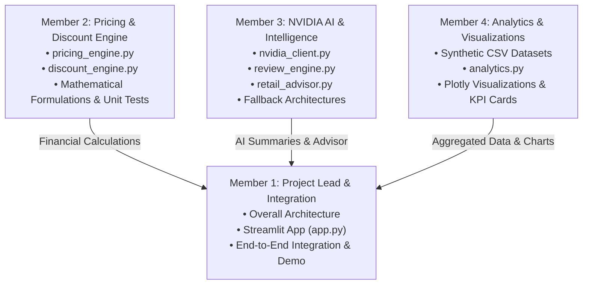

# Team Task Organization & Responsibilities
## Project: RetailPulse AI
**Team Composition:** 4 B.Tech Computer Science & Engineering (AI & ML) Students

---

## 1. Member Roles & Module Allocation

---

## 2. Detailed Task Breakdown

### Member 1: Project Lead & System Integration
- **Primary Files:** `app.py`, `specifications/ARCHITECTURE.md`, `README.md`
- **Responsibilities:**
  - Setup and maintain the main Streamlit application structure and multi-tab routing.
  - Coordinate function calls between Member 2, Member 3, and Member 4's modules.
  - Ensure uniform styling, typography, and professional color palette across all dashboard pages.
  - Lead the end-to-end rehearsal and final viva demonstration.
- **Key Viva Questions to Master:**
  - *What is the architectural distinction between deterministic calculations and LLM generation in this system?*
  - *How does the system ensure zero crashes if the external AI service becomes unreachable?*

### Member 2: Pricing & Discount Engine Developer
- **Primary Files:** `pricing_engine.py`, `discount_engine.py`, `tests/test_pricing.py`, `tests/test_discount.py`
- **Responsibilities:**
  - Implement exact financial formulas: unit cost, gross margin %, markup %, minimum price for target margin.
  - Implement the discount simulator, profit delta calculation, and sales volume uplift formulas.
  - Code the 6 rule-based heuristic discount recommendations.
  - Write and maintain pytest unit test suites ensuring mathematical correctness.
- **Key Viva Questions to Master:**
  - *Derive the formula for Minimum Selling Price given a target gross margin.*
  - *Explain why a 20% discount on a 25% margin product requires a massive sales volume uplift to break even.*

### Member 3: AI & NLP Engineer
- **Primary Files:** `nvidia_client.py`, `review_engine.py`, `retail_advisor.py`
- **Responsibilities:**
  - Implement the NVIDIA NIM client using OpenAI's Python SDK against `https://integrate.api.nvidia.com/v1`.
  - Design resilient system prompts that inject structured facts from Member 2 & 4 without allowing hallucinations.
  - Build the deterministic offline fallback engine for review summarization and business advisory.
  - Create the API configuration test utility.
- **Key Viva Questions to Master:**
  - *How does the OpenAI SDK communicate with NVIDIA NIM microservices?*
  - *What prompt engineering techniques were used to anchor the LLM to actual review text and prevent hallucinations?*

### Member 4: Data Analyst & Dashboard Engineer
- **Primary Files:** `data/*.csv`, `analytics.py`, Plotly visual components in `app.py`
- **Responsibilities:**
  - Curate the 4 synthetic CSV datasets representing the 5 key business scenarios.
  - Implement data loading, sanitization, and metric aggregation in `analytics.py`.
  - Build interactive Plotly charts (sales trend lines, margin comparisons, inventory reorder bars).
  - Format all currency metrics to Indian Rupees (₹) with appropriate thousand separators.
- **Key Viva Questions to Master:**
  - *How do the 5 synthetic product scenarios represent distinct operational challenges in retail?*
  - *How are sales velocity and stock turnover computed across the dataset?*

---

## 3. Collaboration & Contract Guidelines
1. **Never edit each other's core modules without prior notice.**
2. **Function signatures defined in `ARCHITECTURE.md` are binding.**
3. **Run `pytest` after any change to verify nothing broke.**
