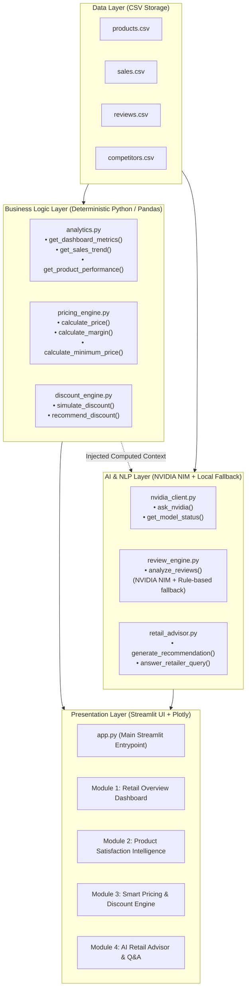

# System Architecture Document
## Project Name: RetailPulse AI

---

## 1. High-Level Architecture Overview

RetailPulse AI follows a layered, modular architecture that cleanly isolates **data ingestion**, **deterministic financial/business calculations**, **NVIDIA NIM LLM intelligence**, and the **Streamlit presentation layer**.

---

## 2. Core Architectural Principles

1. **Separation of Computation and Natural Language:**
   - **Deterministic Engines (Python/Pandas/NumPy):** Execute all arithmetic, financial formulas, statistical aggregations, and business rule evaluation.
   - **NVIDIA AI (LLM):** Restricted strictly to natural-language generation, qualitative review summarization, and strategic contextual advice based solely on injected Python metrics.
   - **Rule:** The LLM is never invoked to sum revenue, compute margins, or invent numerical values.

2. **Zero-Crash Graceful Degradation:**
   - If the NVIDIA NIM API key is unset or network calls fail, the system smoothly falls back to built-in rule-based keyword/sentiment extraction in `review_engine.py` and rule-based conversational responses in `retail_advisor.py`.
   - The user interface displays a polite status badge indicating whether NVIDIA NIM is active or operating in Local Fallback mode.

3. **Stateless Business Functions:**
   - All analytical and financial functions are pure, stateless, and unit-testable without requiring a running web server or API connection.

---

## 3. Module Responsibilities & Interfaces

| Module | Core Responsibility | Key Function Signatures |
| :--- | :--- | :--- |
| `analytics.py` | Load datasets, compute global metrics, sales trends, inventory health | `load_all_data() -> dict` `get_dashboard_metrics(products_df, sales_df) -> dict` `get_sales_trend(sales_df, product_id=None) -> pd.DataFrame` `get_product_performance(products_df, sales_df) -> pd.DataFrame` |
| `pricing_engine.py` | Unit cost, margins, markup, target margin minimum price, competitor delta | `calculate_unit_cost(purchase_cost, variable_cost) -> float` `calculate_margin(selling_price, unit_cost) -> dict` `calculate_minimum_price(unit_cost, target_margin) -> float` `calculate_price_metrics(product_row, competitor_df) -> dict` |
| `discount_engine.py` | Discount simulation, margin preservation check, volume uplift requirement, heuristic recommendations | `simulate_discount(selling_price, unit_cost, target_margin, discount_pct) -> dict` `recommend_discount(product_row, sales_df, reviews_df, competitor_df) -> dict` |
| `nvidia_client.py` | OpenAI client initialization pointing to NVIDIA NIM base URL, payload dispatch | `ask_nvidia(prompt, system_prompt, max_tokens, temperature) -> dict` `is_nvidia_available() -> bool` |
| `review_engine.py` | Aggregate review metrics, extract positive/negative themes via NVIDIA or fallback | `analyze_reviews(product_id, reviews_df, use_ai=True) -> dict` |
| `retail_advisor.py` | Assemble structured product facts and formulate advisor responses | `generate_ai_advisory(product_data, analysis_context) -> str` `answer_retailer_query(query, selected_product, full_context) -> str` |
| `app.py` | Multi-tab/page Streamlit interface with Plotly visualizations | Main execution loop, session state management, page routing |
