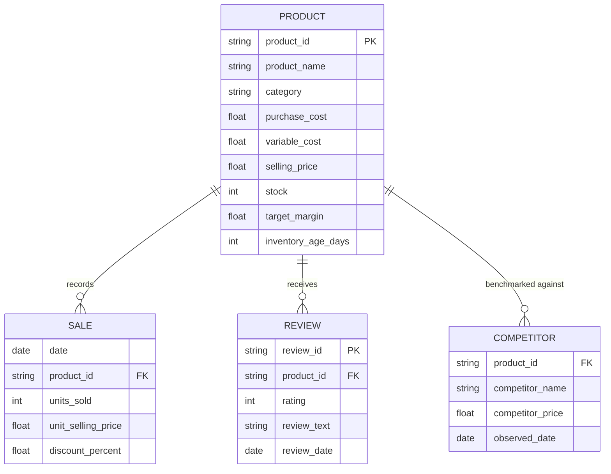

# Data Model & Schema Specification
## Project Name: RetailPulse AI

---

## 1. Overview
RetailPulse AI utilizes 4 normalized CSV files located in the `data/` directory. All data represents realistic synthetic Indian retail scenarios denominated in Indian Rupees (₹).

Foreign key relationships link records via `product_id`.

---

## 2. CSV File Specifications

### 2.1 `products.csv`
Master catalogue of retail products with baseline costs, pricing, and inventory attributes.

| Column | Data Type | Constraints / Format | Description |
| :--- | :--- | :--- | :--- |
| `product_id` | String | Unique Identifier (e.g., `PRD001`) | Primary Key |
| `product_name` | String | Non-empty text | Descriptive product title |
| `category` | String | Electronics, Apparel, Grocery, etc. | Product taxonomy grouping |
| `purchase_cost` | Float | > 0, Currency (₹) | Procurement/Wholesale acquisition cost per unit |
| `variable_cost` | Float | >= 0, Currency (₹) | Direct logistics, packaging, and handling cost per unit |
| `selling_price` | Float | > `purchase_cost` + `variable_cost` | Current standard retail selling price |
| `stock` | Integer | >= 0 | On-hand warehouse/shelf inventory units |
| `target_margin` | Float | Decimal between 0.05 and 0.80 | Target gross margin ratio (e.g., 0.30 for 30%) |
| `inventory_age_days`| Integer | >= 0 | Average age of current stock in inventory |

### 2.2 `sales.csv`
Historical daily/transactional sales records tracking volume, price realized, and discounts applied.

| Column | Data Type | Constraints / Format | Description |
| :--- | :--- | :--- | :--- |
| `date` | Date (YYYY-MM-DD) | Valid historical date | Date of sales record |
| `product_id` | String | Matches `products.product_id` | Foreign Key reference |
| `units_sold` | Integer | >= 0 | Quantity of units sold on this date |
| `unit_selling_price`| Float | > 0, Currency (₹) | Realized selling price per unit |
| `discount_percent` | Float | 0.0 to 50.0 | Promotional discount applied on this transaction |

### 2.3 `reviews.csv`
Customer feedback and qualitative sentiment data.

| Column | Data Type | Constraints / Format | Description |
| :--- | :--- | :--- | :--- |
| `review_id` | String | Unique Identifier (e.g., `REV001`) | Primary Key |
| `product_id` | String | Matches `products.product_id` | Foreign Key reference |
| `rating` | Integer | 1 to 5 | Customer star rating |
| `review_text` | String | Non-empty text | Qualitative review comment describing experience |
| `review_date` | Date (YYYY-MM-DD) | Valid historical date | Date the review was submitted |

### 2.4 `competitors.csv`
Market benchmark pricing from competing retail channels.

| Column | Data Type | Constraints / Format | Description |
| :--- | :--- | :--- | :--- |
| `product_id` | String | Matches `products.product_id` | Foreign Key reference |
| `competitor_name` | String | Retailer name (e.g., "Flipkart", "Amazon India", "Croma") | Competitor entity name |
| `competitor_price`| Float | > 0, Currency (₹) | Benchmark market price observed |
| `observed_date` | Date (YYYY-MM-DD) | Valid date | Observation date of benchmark price |

---

## 3. Five Synthetic Demonstration Scenarios

To demonstrate realistic retail decisions, 5 distinct SKUs are seeded:

1. **Scenario 1: High Sales Velocity & Low Stock (Fast Mover)**
   - **SKU:** `PRD001` - *Organic Darjeeling Green Tea (250g)*
   - **Metrics:** Cost: ₹250, Selling Price: ₹450, Stock: 15 units, Avg Rating: 4.6/5.
   - **Business Dynamics:** High demand, inventory critically low (< 20).
   - **Expected Decision:** Avoid unnecessary discounts; preserve margin; reorder immediately.

2. **Scenario 2: Declining Sales & Recurring Complaints (Defective Inventory - Mandatory Demo SKU)**
   - **SKU:** `PRD002` - *Aura Sound Wireless Bluetooth Headphones*
   - **Metrics:** Purchase Cost: ₹1,000, Variable Cost: ₹50, Selling Price: ₹1,499, Stock: 100 units, Avg Rating: 3.2/5.
   - **Business Dynamics:** Sales declining over the last 30 days. Reviews consistently cite battery draining within 2 hours, faulty charging case.
   - **Expected Decision:** DO NOT apply a blanket discount. Investigate product quality / contact supplier first; price cuts will not fix customer dissatisfaction.

3. **Scenario 3: Declining Sales & Excess Stock with Healthy Quality (Promotion Candidate)**
   - **SKU:** `PRD003` - *Ergonomic Memory Foam Office Cushion*
   - **Metrics:** Cost: ₹600, Selling Price: ₹1,299, Stock: 140 units, Avg Rating: 4.4/5. Target Margin: 35%.
   - **Business Dynamics:** Satisfied customers, but demand slowed down due to seasonal slump; excess stock accumulating.
   - **Expected Decision:** Test a small controlled promotional discount (10-15%); margin allows room for promotion to stimulate volume.

4. **Scenario 4: High Satisfaction & Healthy Stable Sales (Cash Cow)**
   - **SKU:** `PRD004` - *Stainless Steel Thermal Water Bottle (1L)*
   - **Metrics:** Cost: ₹400, Selling Price: ₹799, Stock: 65 units, Avg Rating: 4.8/5.
   - **Business Dynamics:** Consistent daily sales, stellar customer reviews on durability and insulation.
   - **Expected Decision:** Maintain current price; premium positioning is justified.

5. **Scenario 5: Slow-Moving Old Inventory (Clearance / Phased Markdown)**
   - **SKU:** `PRD005` - *Vintage Canvas Travel Duffel Bag*
   - **Metrics:** Cost: ₹900, Selling Price: ₹1,899, Stock: 45 units, Inventory Age: 95 days, Avg Rating: 3.9/5.
   - **Business Dynamics:** Aging inventory (> 90 days), capital locked up, low sales velocity.
   - **Expected Decision:** Implement a phased markdown clearance strategy to recover working capital.
